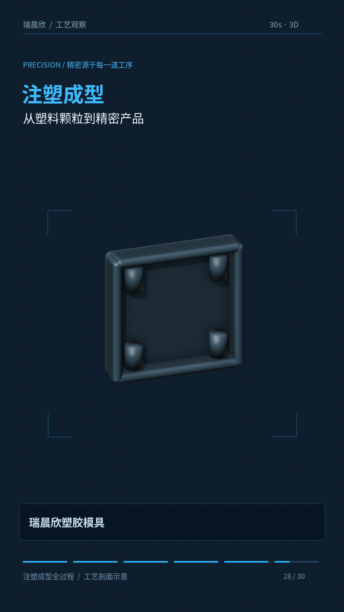
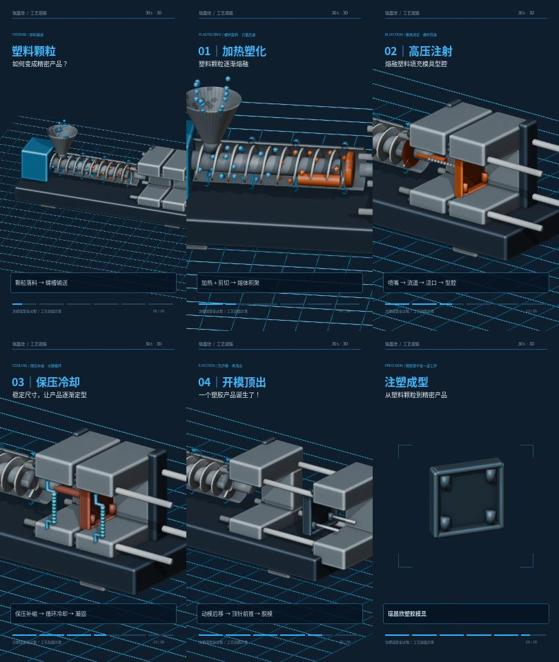

# 注塑成型全过程 · 三维科普动画

30 秒，9:16 竖屏，1080×1920，30FPS。Blender 程序化三维动画，包含动态简体中文字幕和同步机械音效；无配音、无背景音乐。

## 下载成片与项目

在 GitHub 文件页面点击 **Download raw file** 下载；下方视频链接可直接下载。

- [完整有声视频（MP4）](complete.mp4?raw=true)
- [静音视频（MP4）](silent.mp4?raw=true)
- [独立音效总轨（48kHz 立体声 WAV）](sound_effects.wav?raw=true)
- [完整项目源码包（含可播放 Blender 工程与字体）](project_source.zip?raw=true)
- [低分辨率检查预览](preview.mp4?raw=true)
- [可播放 Blender 场景](project/injection.blend?raw=true)

## 时间轴

| 时间 | 工艺内容 |
| --- | --- |
| 0–5 秒 | 颗粒落料与螺槽输送 |
| 5–10 秒 | 加热、剪切塑化；螺杆计量后退 |
| 10–16 秒 | 闭模高压注射、型腔填充 |
| 16–22 秒 | 保压与循环水冷却，产品凝固 |
| 22–27 秒 | 开模、顶针顶出、产品落料 |
| 27–30 秒 | 成品旋转展示与瑞晨欣塑胶模具署名 |

## 源代码与修改

查看 [项目说明](project/README.md)。核心文件：

- [build.py](project/build.py)：三维模型、螺杆、模具、相机和机械运动。
- [finish.py](project/finish.py)：动态中文字幕、图形包装、音效合成与编码。
- [bake.py](project/bake.py)：将程序化运动烘焙为 Blender 关键帧。
- [render.sh](project/render.sh)：完整重建入口，需要 Blender 4.3+、FFmpeg、Python、NumPy、Pillow。
- [静态字幕文本](project/subtitles.srt)：用于后续编辑，动态字幕以 finish.py 为准。

本片为三维工艺剖面示意，熔体使用几何与流向可视化，未进行 CFD 仿真。机械音效为程序合成。Noto 字体许可随项目附带。

## 独立音效分轨

所有 WAV 均为 30 秒，从时间轴 0 秒开始对齐，方便直接叠放。

- [电机与螺杆](motor.wav?raw=true)
- [颗粒碰撞](pellets.wav?raw=true)
- [液压、开模、顶出与落料](hydraulics.wav?raw=true)
- [冷却水](cooling_water.wav?raw=true)
- [科技转场与结束提示](transitions.wav?raw=true)
- [音效时间表](sound_cues.csv)

## 检查记录

[机械时序](mechanical_checks.json)、[媒体规格](media_checks.json)、[音效规格](audio_checks.json)。
已验证完整视频可解码，有声版与静音版视频流一致，静音版无音轨，Blender 工程可独立播放，源码 ZIP 校验通过。

